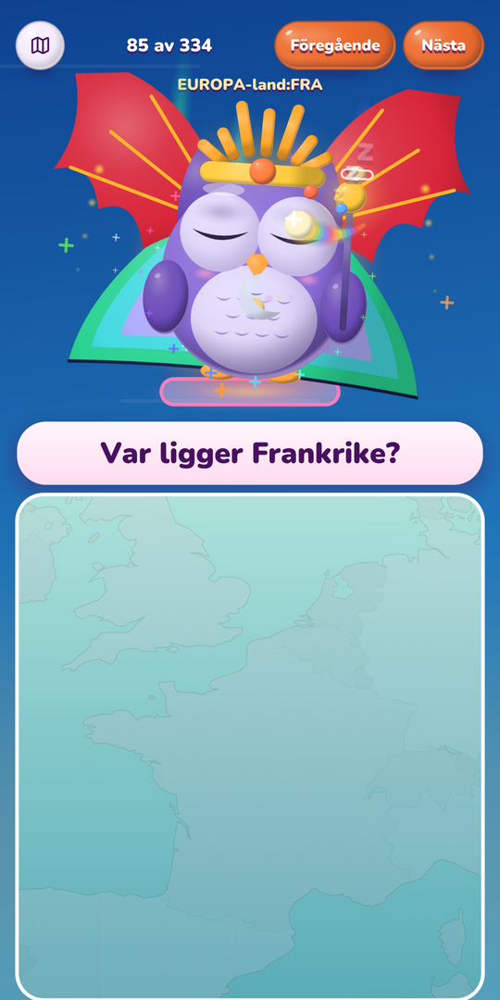
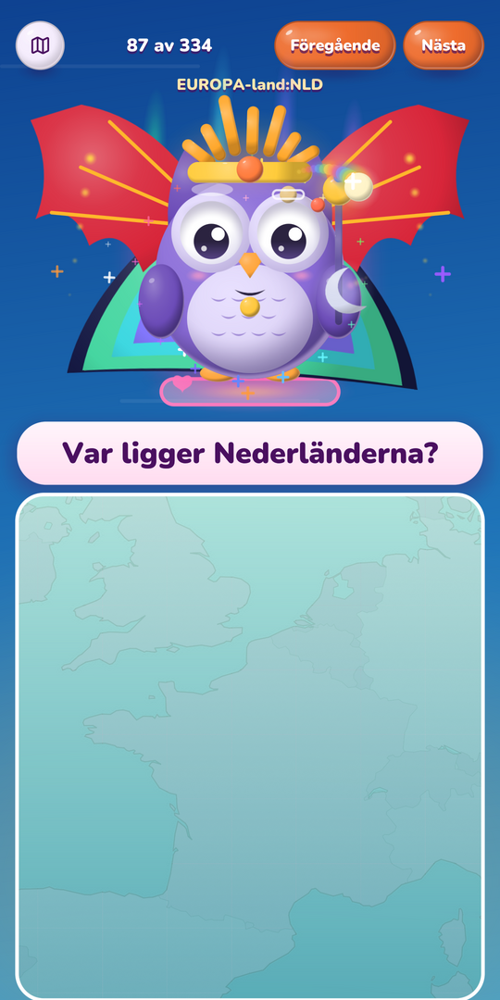
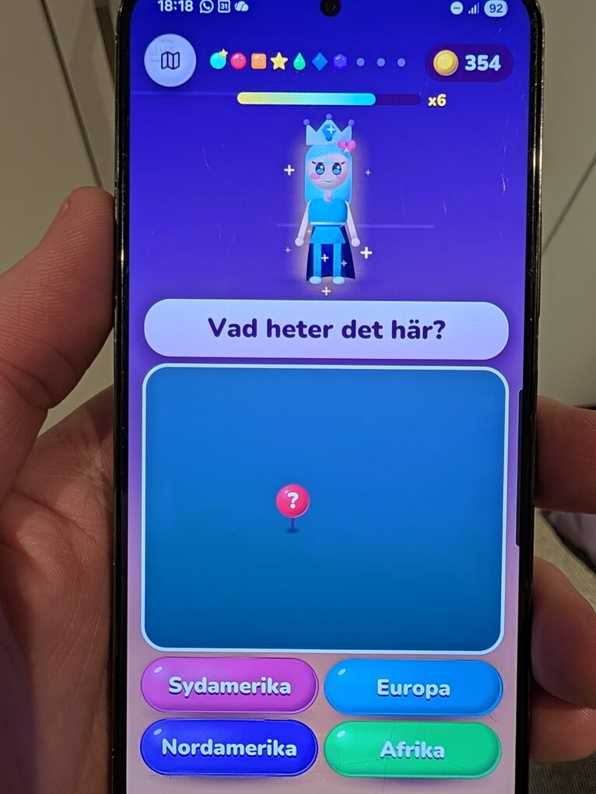
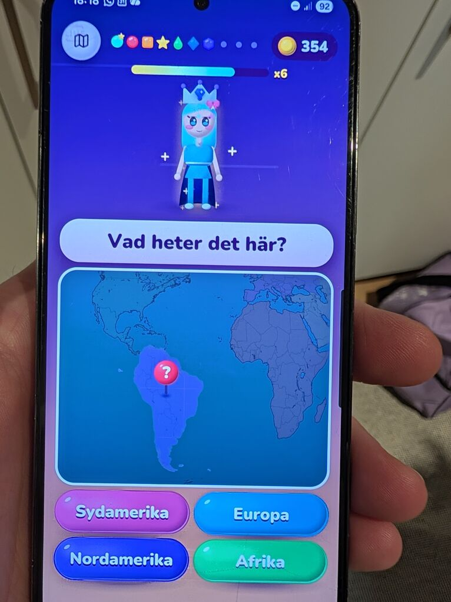
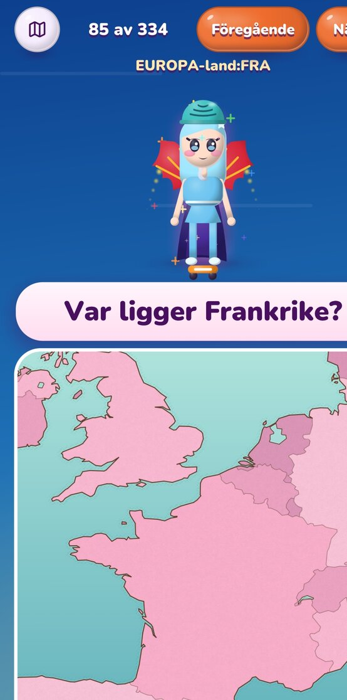
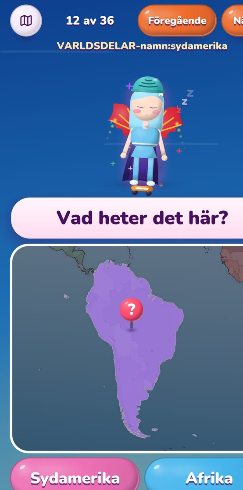
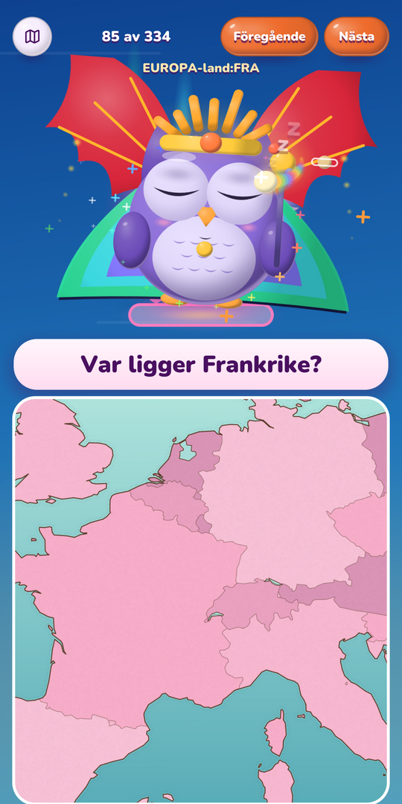
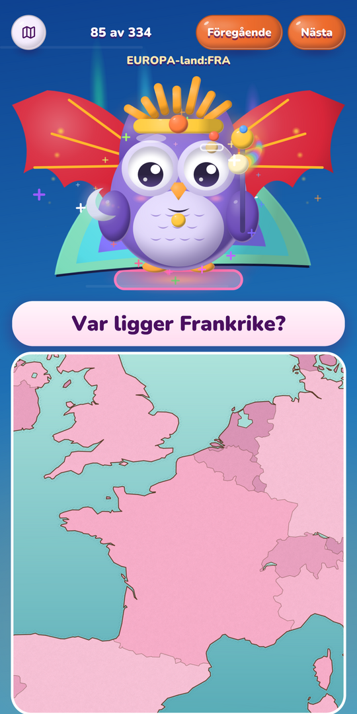
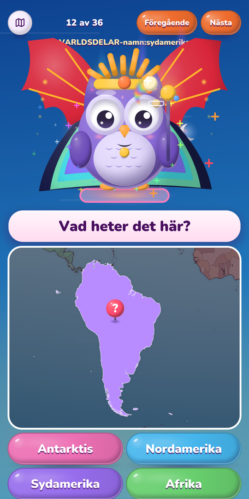

# Test run 2026-10-13: images drawn small on two phones

Läxkompis (a Swedish homework game on gunim) drawn on two Android
phones, after it moved from gunim 4eb721f to 7b617f9, which brings
414319f, "render: make mipmaps with a pass of our own, not
glGenerateMipmap".

## Machines

- Google Pixel 11 Pro (grizzly), Android 17, 1080 × 2410 at 420 dpi,
  scale 2.625.
- Samsung Galaxy S22 (SM-S901B, Exynos 2200, Xclipse 920 GPU),
  1080 × 2340.
- Go 1.25, Läxkompis main f1d8db8, built with gunimapk; installed
  side by side as a development build.

What shows it: Läxkompis's world map is drawn as 256-pixel image tiles
(paint.Image), each drawn at half to whole its size, so every frame
samples its mipmaps. On the desktop (Linux, Mesa) it looks right.

## 1. gunim 7b617f9 (with 414319f): fail

The Pixel draws the map's land as a faint ghost of itself, its outlines
barely there:

The S22 draws no land at all when zoomed in, only the sea and the pin
(a photo of the phone); zoomed out, where the tiles are drawn at more
than their size and no mipmap is sampled, the land is there:

## 2. gunim 4eb721f (before 414319f): pass

The same Läxkompis with only gunim set back: the Pixel draws the land
whole on the same three questions.

## 3. gunim master 38f6528 with the fix (219a662): pass

glGenerateMipmap again, but on Windows. Both phones draw the land
whole, on the same questions as in 1:

## 4. gunim #116 (94b3865, mipmaps drawn into a scratch texture): pass on the Pixel

Läxkompis main with gunim at #116's head, on the Pixel 11 Pro
(2026-10-14): the land whole on the same questions. The S22 is still to
test.

